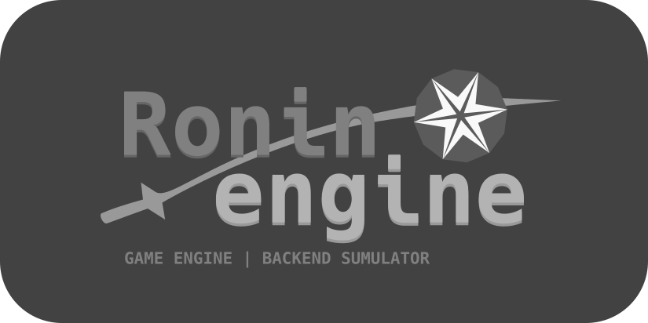

# Ronin Engine

<h1 align="center">
    
</h1>

<p align="center">
    <b>A modern, high-performance 2D C++ game engine and visual editor built with SDL2, Box2D, and Dear ImGui.</b>
</p>

---

## Overview

**Ronin Engine** is a modular, lightweight 2D game engine designed for high performance and rapid game development in modern C++ (C++17/C++20). It offers an intuitive **GameObject-Component (ECS-style)** architecture, hardware-accelerated 2D graphics, rigid-body physics powered by **Box2D**, dynamic 2D lighting, spatial audio, and an integrated visual editor (**Ronin Editor**) powered by **Dear ImGui**.

---

## Key Features

### Core Architecture & Scene Management
- **GameObject & Component Model**: Modular component lifecycle (`OnAwake()`, `OnStart()`, `OnUpdate()`, `OnGizmos()`, `OnDestroy()`).
- **Transform Hierarchy**: Robust scene graph with parent-child relationships, local/world positions, scale, and full rotation support.
- **World System**: Dynamic loading, switching, and unloading of scenes (`.world` format).
- **Persistent Identification**: Unique 32-bit identifiers for all GameObjects and Components for serialization, reference tracking, and editor tooling.

### 2D Physics Simulation (Box2D)
- **`Rigidbody2D`**: Full rigid-body physics simulation with **Dynamic**, **Kinematic**, and **Static** body types.
  - Configurable mass, linear drag, angular drag, gravity scale, velocity, forces, and torque impulses.
- **`BoxCollider2D`**: Axis-aligned and oriented bounding boxes with customizable size, offset, restitution (bounciness), friction, and sensor/trigger modes.
- **Synchronized Rotation & Position**: Real-time bidirectional synchronization between Ronin transforms and Box2D physics bodies.

### Graphics & 2D Rendering
- **`SpriteRenderer`**: Fast sprite rendering supporting texture atlases, color tinting, horizontal/vertical flipping, and fallback primitive shapes (Rectangle, Circle).
- **`Camera2D`**: Orthographic camera with smooth following, zoom, viewport scaling, aspect ratio letterboxing, and screen-to-world coordinate transformations.
- **Dynamic 2D Lighting**:
  - `SimpleLight`: Omni-directional point light with radius and intensity falloff.
  - `Spotlight`: Directed cone light with customizable angle and smooth edge attenuation.
  - `DirectLight`: Global directional sunlight.
- **Text & UI Rendering**: High-quality font rendering using SDL2_ttf.

### Audio Subsystem
- **Spatial Audio**: Powered by SDL2_mixer.
- **`AudioSource` & `AudioClip`**: Playback controls for 2D and positional sound, looping, volume, panning, and automatic format duration detection.

### Ronin Visual Editor
- **Dear ImGui Docking Interface**: Customizable multi-panel layout with dark theme.
- **Scene Viewport**:
  - Interactive camera pan and zoom, coordinate grid overlay, and component gizmos.
  - Single and multi-object selection directly inside the viewport.
  - Play-in-Editor and Pause simulation controls.
- **Hierarchy Panel**:
  - Tree visualization with parent-child nesting.
  - Multi-select support (<kbd>Ctrl</kbd>+Click / <kbd>Shift</kbd>+Click).
  - Quick shortcuts: Duplicate (<kbd>Ctrl+D</kbd>), Rename (<kbd>F2</kbd>), Delete (<kbd>Delete</kbd>).
- **Inspector Panel**:
  - Real-time property inspection and editing for Transform, SpriteRenderer, Camera2D, Rigidbody2D, BoxCollider2D, Lights, and Audio.
  - Reset to default values for individual properties or entire components.
  - Copy, Paste, and Duplicate Component functionality.
  - Integrated asset pickers and quick reference assignment.
- **Asset Browser & Quick Search**:
  - Directory tree and grid file explorer with asset thumbnail previews.
  - Fast Asset Finder dialog (<kbd>Ctrl+Shift+P</kbd>) filterable by name, type, and Asset ID.
  - Drag-and-drop asset binding into inspector slots.
- **Sprite Editor**:
  - Visual spritesheet viewer with pan and zoom.
  - Automatic alpha-boundary trimming and Grid Slicing tools.
  - Custom pivot setting and sprite slicing export.
- **Terrain & Tile Editor**: Interactive 2D terrain layout and tilemap editing.
- **Console Panel**: Filterable runtime log viewer (Info, Warning, Error) with message collapse.
- **Multi-Level Undo / Redo**: Full transaction history (<kbd>Ctrl+Z</kbd> / <kbd>Ctrl+Y</kbd>).

---

## Dependencies & Prerequisites

### Required System Libraries
- **CMake**: version 3.16 or higher
- **C++ Compiler**: GCC 11+, Clang 13+, or MSVC 2019+ (C++17 support required)
- **SDL2**: core multimedia library
- **SDL2_image**: image format decoders (PNG, JPG, BMP)
- **SDL2_mixer**: audio mixer and sound playback
- **SDL2_ttf**: TrueType font rendering engine

### Package Installation

#### Ubuntu / Debian
```bash
sudo apt-get update
sudo apt-get install -y build-essential cmake \
    libsdl2-dev libsdl2-image-dev libsdl2-mixer-dev libsdl2-ttf-dev
```

#### Fedora
```bash
sudo dnf install -y gcc-c++ cmake \
    SDL2-devel SDL2_image-devel SDL2_mixer-devel SDL2_ttf-devel
```

#### Arch Linux
```bash
sudo pacman -S base-devel cmake sdl2 sdl2_image sdl2_mixer sdl2_ttf
```

---

## Building the Engine

### 1. Clone the Repository
```bash
git clone https://github.com/badcast/ronin-engine.git
cd ronin-engine
```

### 2. Configure with CMake
The Ronin Editor is enabled by default (`RONIN_EDITOR_BUILD=ON`). You can toggle it via CMake options:

```bash
# Configure Release build with Editor enabled
cmake -B build -DCMAKE_BUILD_TYPE=Release -DRONIN_EDITOR_BUILD=ON
```

### 3. Build the Project
```bash
cmake --build build -j$(nproc)
```

The resulting binaries will be placed in:
- Engine shared library: `build/lib/libRoninEngine.so` (or `.dll` on Windows)
- Visual Editor executable: `build/bin/RoninEditor` (or `build/editor/RoninEditor`)
- Test suites: `build/bin/tests/`

---

## Running the Visual Editor

Launch the editor directly from the project directory:
```bash
./build/editor/RoninEditor
```

### Editor Keyboard Shortcuts
| Shortcut | Action |
| :--- | :--- |
| <kbd>Ctrl</kbd> + <kbd>Z</kbd> | Undo last action |
| <kbd>Ctrl</kbd> + <kbd>Y</kbd> / <kbd>Ctrl</kbd> + <kbd>Shift</kbd> + <kbd>Z</kbd> | Redo action |
| <kbd>Ctrl</kbd> + <kbd>D</kbd> | Duplicate selected GameObject(s) |
| <kbd>Ctrl</kbd> + <kbd>Shift</kbd> + <kbd>P</kbd> | Open Asset Finder (Quick Search) |
| <kbd>F2</kbd> | Rename selected GameObject |
| <kbd>Delete</kbd> | Delete selected GameObject(s) |
| <kbd>F</kbd> | Focus Viewport Camera on selected object |
| <kbd>W</kbd> / <kbd>E</kbd> / <kbd>R</kbd> | Select Translate / Rotate / Scale gizmo |

---

## Running Automated Tests

Ronin Engine includes a comprehensive automated test suite covering Core ECS, Transform hierarchies, 2D Physics, Lights, and Editor systems:

```bash
ctest --test-dir build --output-on-failure
```

---

## Quick Start Code Example

Here is a simple example showing how to create a GameObject with physics and movement in C++:

```cpp
#include <ronin/ronin.h>

using namespace RoninEngine::Runtime;

class PlayerController : public Component
{
public:
    float speed = 200.0f;
    Rigidbody2D *rb = nullptr;

    void OnStart() override
    {
        rb = GetComponent<Rigidbody2D>();
    }

    void OnUpdate() override
    {
        Vec2 movement = Vec2::zero;
        if (Input::GetKeyDown(KeyCode::A) || Input::GetKeyDown(KeyCode::LeftArrow))
            movement.x -= 1.0f;
        if (Input::GetKeyDown(KeyCode::D) || Input::GetKeyDown(KeyCode::RightArrow))
            movement.x += 1.0f;

        if (rb != nullptr)
        {
            rb->setVelocity({movement.x * speed * Time::deltaTime(), rb->getVelocity().y});
        }
        else
        {
            transform()->position += movement * speed * Time::deltaTime();
        }
    }
};

int main(int argc, char *argv[])
{
    // Initialize Ronin Engine
    RoninEngine::Init(RoninEngine::RoninInitFlags::FlagsAll);

    // Create World and Player
    World *world = World::Create("MainWorld");
    GameObject *player = world->CreateGameObject("Player");
    player->AddComponent<SpriteRenderer>();
    player->AddComponent<Rigidbody2D>()->setBodyType(BodyType::Dynamic);
    player->AddComponent<BoxCollider2D>()->setSize({32.0f, 32.0f});
    player->AddComponent<PlayerController>();

    // Start Main Simulation Loop
    RoninEngine::Run(world);

    return 0;
}
```

---

## Project Structure

```text
ronin-engine/
├── 3rdParty/             # Third-party vendor libraries (Box2D, Dear ImGui, nlohmann-json)
├── config/               # CMake configuration templates and Windows resource scripts
├── editor/               # Ronin Visual Editor (Dear ImGui Docking UI, Asset Manager, Editors)
│   ├── include/          # Editor header files
│   └── src/              # Editor implementation files (Viewport, Inspector, Hierarchy, etc.)
├── include/ronin/        # Public engine header API
├── media/                # Engine brand assets, logos, and icons
├── src/                  # Core engine source files
│   ├── core/             # Base primitives, memory, math, time, and input
│   ├── sim/              # GameObject, Component, Transform, Camera2D, Lights, Physics
│   ├── gfx/              # 2D rendering pipeline and texture management
│   └── audio/            # SDL2_mixer audio management
└── tests/                # Automated CTest test suites
```

---

## License

Ronin Engine is licensed under the [MIT License](LICENSE).
Third-party libraries retain their respective open-source licenses (Box2D: MIT, Dear ImGui: MIT, SDL2: zlib).
